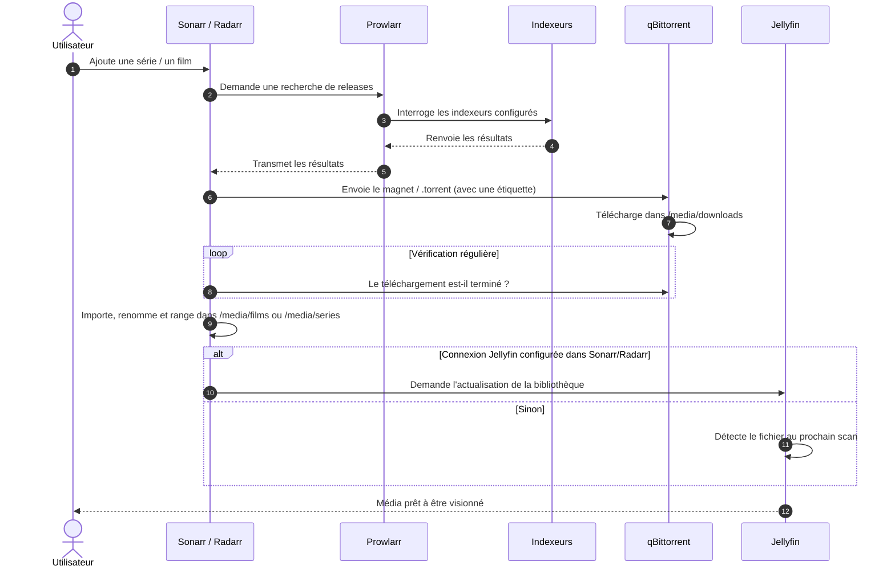

# Parcours d'un média
 
Du moment où j'ajoute un film ou une série jusqu'à sa lecture dans Jellyfin.
 

 
Les indexeurs sont synchronisés une seule fois de Prowlarr vers Sonarr / Radarr, ce que ce schéma ne montre pas.
